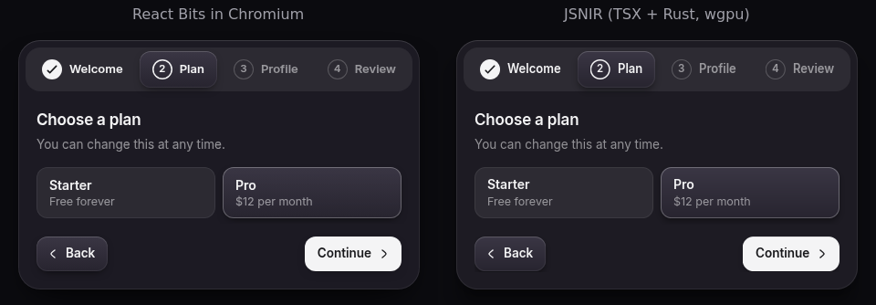

# JSNIR · JavaScript Native In Rust

**JSNIR** is a standalone native desktop UI engine written in Rust that runs TypeScript/TSX apps
**with no WebView, no DOM, and no Chromium**.

Application logic runs on a dedicated off-UI thread inside a pluggable JavaScript VM (**QuickJS-ng**
by default for minimal footprint, or opt-in **V8** via `jsnir-v8` for TurboFan JIT workloads).
Rust owns the window, native IME, text editing, Taffy flexbox layout, CSS-like transitions and
keyframe animations, persistent GPU texture atlas, and `wgpu` rendering — so heavy JS work never
freezes scrolling, typing, or 120 Hz animations.



On the same 4-step [Stepper comparison](comparison/stepper/README.md) (Ryzen + Radeon 780M, Vulkan/Wayland):

- **390 lines of TSX** vs **1,736 lines of Rust** in GPUI (`4.4×` less code).
- **0.07–0.12%** pixel diff vs Chromium reference (GPUI: `0.18–0.36%`).
- **`15.0 MB`** stripped binary and **`121 MB`** Vulkan peak RSS with QuickJS-ng (GPUI: `19.6 MB` / `109 MB`).
- **`1.37 ms`** AOT cold start (QuickJS `.jsbc`), **`0.41 ms`** in-place hot reload (V8), and **1 draw call** GPU batching (`533 µs` steady frame on Radeon 780M).

See the full reproducible numbers in **[docs/benchmarks.md](docs/benchmarks.md)**.

---

## Key Architecture Highlights

- **Single-process, off-UI-thread JS**: zero DOM/Blink/Node.js overhead; JS stalls never drop UI frames.
- **100% Binary Command Protocol**: zero-JSON typed events (`jsnirDrag`, `jsnirScroll`, `jsnirContextMenu`) and a shared `Uint32Array`/`Float32Array` command buffer + string pool (`4.65×` faster than JSON batching, `JSON calls = 0` across the SDK).
- **Pluggable `JsEngine` / `JsEngineFactory` trait**:
  - **QuickJS-ng (default)**: `~6.4 MiB` stripped headless binary, `~9.0 MiB` RSS, `.jsbc` AOT bytecode (`0.51–1.20 ms` startup), `VmLimits` (memory ceiling + interrupt timeout).
  - **V8 opt-in (`crates/engine-v8`)**: TurboFan JIT + shared `v8::BackingStore` + V8 Fast API (`jsnir.set` / `jsnir.commit` at `~15 ns/op`) + in-place `Isolate` recycling (`0.41 ms` hot reload), `3.5–35×` faster on heavy JS/SDK workloads with zero impact on default builds.
- **High-throughput `wgpu` renderer**: persistent `4096×2048` shelf texture atlas, instanced draw-call batching (`1501 → 1` draw call on a dense 2D grid), `O(1)` steady-state view cache, rounded fills, gradients, inner/outer shadows, rounded clips, masks, and opacity layers.
- **Native multiplatform IME**:
  - **Linux Wayland**: native `zwp_text_input_v3` (v1 & v2) over an isolated `wl_event_queue` (`set_surrounding_text`, `set_text_change_cause`, semantic `content_hint`/`content_purpose`, `delete_surrounding_text`, atomic 7-step `done`).
  - **Windows**: Win32 `HWND` subclass decoding multi-clause CJK `GCS_COMPATTR` (`PreeditSegments`), `WM_IME_REQUEST` (`IMR_DOCUMENTFEED`, `IMR_RECONVERTSTRING`, `IMR_QUERYCHARPOSITION`), `ImmNotifyIME(CPS_CANCEL)`, and TSF `SetInputScope`.
  - **Linux X11 / macOS**: deduplicated `winit` fallback with input-to-input focus reset.
- **Native Accessibility (AccessKit) & Keyboard Navigation**: full semantic tree via `accesskit` + `accesskit_winit` (Linux AT-SPI, Windows UIA, macOS NSAccessibility) with lazy activation (0 µs when inactive), incremental tree diffing, `TextRun` selection/editing, ARIA `Paint.a11y` metadata (100% binary), and `Tab`/`Shift+Tab` focus traversal with modal focus trapping.
- **Vite-style `jsnir` CLI (`crates/dev`)**: in-memory multi-file TSX/TS compilation via **Oxc** (`~2–5 ms`), signal-preserving hot reload, native in-window error overlay, background `tsc --noEmit`, TTY shortcuts, and `--bytecode` AOT builds.
- **Single-source Rust↔TypeScript contract**: declared once in [src/contract.rs](src/contract.rs) and generated into [app/jsnir.d.ts](app/jsnir.d.ts) (`JSNIR_UPDATE=1 cargo test contract`).

---

## Quickstart (`jsnir` CLI)

```sh
# 1. Build the lightweight CLI (QuickJS-ng default, zero V8)
cargo build --release --manifest-path crates/dev/Cargo.toml

# 2. Scaffold and start a new TSX project with instant Oxc hot reload
./crates/dev/target/release/jsnir init my-app
cd my-app
../crates/dev/target/release/jsnir dev

# 3. Build a standalone JS or AOT QuickJS bytecode (`.jsbc`) production bundle
../crates/dev/target/release/jsnir build
../crates/dev/target/release/jsnir build --bytecode

# 4. Run a compiled bundle directly
../crates/dev/target/release/jsnir run dist/app.jsbc
```

### Opt-in V8 JIT engine (`--features engine-v8`)

For apps with heavy JS logic (parsers, large grids, massive dynamic lists), compile the CLI or GPU
runtime with `--features engine-v8` and pass `--engine v8` (or set `engine = "v8"` under `[app]` in
`jsnir.toml`):

```sh
cargo run --release --manifest-path crates/dev/Cargo.toml --features engine-v8 -- dev my-app --engine v8
```

---

## Example TSX Component

Components run once on mount; fine-grained signals update only the nodes that read them. Transitions,
hover, press states, and animations run natively in Rust on the UI thread ([app/stepper.tsx](app/stepper.tsx)):

```tsx
function Option(props: { title: string; detail: string; selected: () => boolean; onSelect: () => void }): Element {
    return (
        <Row
            style={{ grow: 1, basis: 0, align: "center", justify: "between", gap: 12, padding: [11, 14, 11, 14] }}
            onPress={props.onSelect}
            paint={() => {
                const selected = props.selected();
                return {
                    radius: 12,
                    background: selected ? undefined : well,
                    gradient: selected ? tile : undefined,
                    edge: selected ? ring : tileEdge,
                    shadows: selected ? [tileShadow] : [],
                    transitions: [ease("background", 200), ease("edge", 200)],
                };
            }}
        >
            <Box style={{ gap: 2 }}>
                <Text font={{ size: 14, weight: 600 }} paint={{ color: ink }}>{props.title}</Text>
                <Text font={{ size: 12.5 }} paint={{ color: muted }}>{props.detail}</Text>
            </Box>
        </Row>
    );
}
```

### Run the Stepper Demo

```sh
# Fetch pinned native TypeScript compiler once (or use `npm ci`)
JSNIR_TSC=$(bash scripts/fetch-tsc.sh target/typescript)
export JSNIR_TSC

cargo run --release --features stepper --manifest-path backends/gpu/Cargo.toml -- stepper
```

Flags: `--engine quickjs|v8` (when built with `--features engine-v8`), `--step N`, `--name NAME`,
`--plan pro|starter`, `--focus`, `--offscreen file.ppm`.

---

## Repository Layout

| Path | Contents |
| --- | --- |
| [src/](src) | Core engine: tree & batches ([tree.rs](src/tree.rs)), pluggable JS engine trait + QuickJS-ng ([engine/](src/engine)), binary command protocol ([cmd.rs](src/cmd.rs)), Rust↔TS contract ([contract.rs](src/contract.rs)), UI host & layout ([host.rs](src/host.rs)), transitions ([motion.rs](src/motion.rs)), line editor + IME core ([editor.rs](src/editor.rs)), `cosmic-text` engine ([text.rs](src/text.rs)), virtual list ([list.rs](src/list.rs)) |
| [crates/engine-v8](crates/engine-v8) | Standalone opt-in V8 JIT backend (`jsnir-v8`): TurboFan, shared `BackingStore`, V8 Fast API, in-place reload, `VmLimits` watchdog, parity suite & comparative benchmark |
| [crates/dev](crates/dev) | Vite-style `jsnir` CLI & embeddable dev watcher: Oxc multi-file TSX compiler, signal-preserving hot reload, error overlay, async `tsc`, `--bytecode` AOT, `--engine quickjs\|v8` |
| [backends/gpu](backends/gpu) | Native `winit` + `wgpu` backend: persistent shelf atlas, 1-draw-call instanced renderer, native Wayland `zwp_text_input_v3` & Windows IMM32/TSF IME ([ime/](backends/gpu/src/ime)), `arboard` clipboard |
| [backends/egui](backends/egui) | Historical `egui` measurement baseline |
| [app/](app) | Fine-grained TSX [SDK](app/sdk.ts), generated [jsnir.d.ts](app/jsnir.d.ts), and example/test screens ([stepper.tsx](app/stepper.tsx), [chat.tsx](app/chat.tsx)) |
| [examples/](examples) | Reproducible release microbenchmarks (`bridge_bench`, `frame_bench`, `sdk_bench`) |
| [comparison/stepper](comparison/stepper) | Side-by-side Stepper port in Chromium, GPUI, and JSNIR with captures and metrics |
| [docs/](docs) | [Benchmarks](docs/benchmarks.md), [Roadmap](docs/roadmap.md), [Releases](docs/releases.md), and [Research notebook](docs/research.md) |

---

## Tests & Benchmarks

```sh
# Core engine (zero-engine check + full QuickJS/contract/host tests)
cargo check --no-default-features
cargo test --features "examples stepper" -- --test-threads=4

# Native GPU renderer + Wayland/Windows IME protocol tests
cargo test --manifest-path backends/gpu/Cargo.toml --features "examples stepper"

# Vite-style CLI (default QuickJS + opt-in V8)
cargo test --manifest-path crates/dev/Cargo.toml
cargo test --manifest-path crates/dev/Cargo.toml --features engine-v8

# Opt-in V8 JIT parity, Fast API, in-place reload & VmLimits suite
cargo test --manifest-path crates/engine-v8/Cargo.toml

# TypeScript contract check
npm run typecheck
```

---

## Documentation

- **[Performance & Benchmarks (Electron vs GPUI vs JSNIR · QuickJS vs V8)](docs/benchmarks.md)**
- **[Stepper Comparison: Chromium vs GPUI vs JSNIR](comparison/stepper/README.md)**
- **[Roadmap](docs/roadmap.md)**
- **[Research Notebook](docs/research.md)**
- **[External App & Release Guide](docs/releases.md)**

## License

JSNIR is licensed under [MIT](LICENSE). Inter uses the [SIL Open Font License](assets/fonts/Inter-LICENSE.txt), and Hugeicons Free uses [MIT](assets/icons/Hugeicons-LICENSE.txt).
