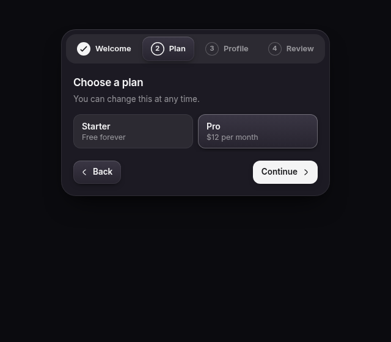
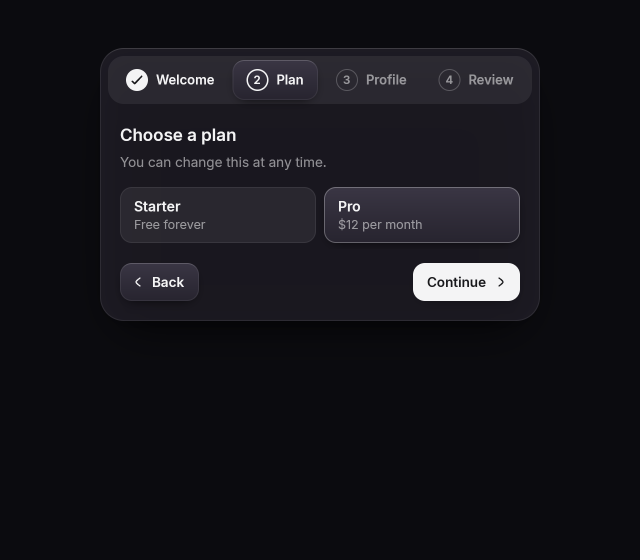
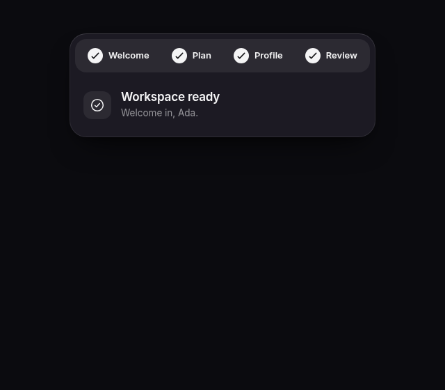

# Stepper: React Bits ported to JSNIR and to GPUI

The [React Bits Stepper](https://reactbits.dev) "onboarding" demo, a four-step form with an animated header,
built three ways under one [spec](SPEC.md): the original component in Chromium (the reference), a native
GPUI port, and a JSNIR port written in TSX. Same font (Inter 4.1), same 640 × 560 window, same states.

| | Reference | JSNIR | GPUI |
| --- | --- | --- | --- |
| Source | [React Bits @ fefc5b0](https://github.com/DavidHDev/react-bits/tree/fefc5b05ca34a7475b38a977127441fbfad2f177/src/content/Components/Stepper) (built by [react/build.sh](react/build.sh)) | [app/stepper.tsx](../../app/stepper.tsx) | [gpui/src/main.rs](gpui/src/main.rs) |
| Language of the screen | JSX + CSS | TSX (runs in QuickJS, off the UI thread) | Rust |

## Run

```sh
# JSNIR (from the repository root)
cargo run --release --locked --manifest-path backends/gpu/Cargo.toml --target-dir target -- stepper
cargo run --release --locked --manifest-path backends/gpu/Cargo.toml --target-dir target -- stepper --step 3 --name Ada --focus

# GPUI
cargo run --release --manifest-path comparison/stepper/gpui/Cargo.toml -- --step 3 --name Ada --focus

# Reference: comparison/stepper/react/build.sh once, then open react/index.html?step=2 in a browser
```

Both native ports accept `--step N` (5 = completed), `--name`, `--plan pro|starter` and `--focus`.

## Visual fidelity

Pixels that differ from the Chromium reference by more than 6 % (`magick compare -metric AE -fuzz 6%`):

| State | What it shows | JSNIR | GPUI |
| --- | --- | ---: | ---: |
| s1 | Step 1 | 0.08 % | 0.24 % |
| s2 | Step 2, Pro selected | 0.13 % | 0.25 % |
| s3 | Profile, empty field, Continue disabled | 0.10 % | 0.31 % |
| s4 | Profile, "Ada", field focused | 0.12 % | 0.36 % |
| s5 | Review | 0.10 % | 0.30 % |
| s6 | Completed | 0.14 % | 0.18 % |

What remains in both is glyph antialiasing. The comparison is not fully even: JSNIR captures render
offscreen at scale 1 ([capture-jsnir.sh](capture-jsnir.sh)), while GPUI has no offscreen path, so its
captures are screenshots of a 2× window scaled down to 1×, which adds resampling error to its numbers.

| Reference | JSNIR | GPUI |
| --- | --- | --- |
|  |  |  |
|  |  |  |
|  |  |  |

## Cost

Measured on this machine (Ryzen with Radeon 780M, Vulkan, Wayland). Peak RSS is read from `/proc` after the
window has drawn for 3 s.

| | JSNIR | GPUI |
| --- | ---: | ---: |
| Lines written for the screen | 389 (TSX) | 1,162 (Rust) + 574 adapted text field |
| Release binary, stripped | 15.0 MB ¹ | 19.6 MB |
| Peak RSS | 121 MB | 109 MB |
| Clean release build | 42 s ² | 74 s ² |

¹ The JSNIR binary also holds the chat app and the QuickJS VM.
² Different load on the machine during each build: take it as an order of magnitude.

## The same button in each

The Continue button: hover darkens it, pressing scales it to 0.96, and it fades to 40 % while the name is
missing. In JSNIR the screen declares the states and transitions, and Rust runs them every frame without
calling JS:

```tsx
<Row
    style={{ height: 38, align: "center", gap: 6, padding: [0, 11, 0, 14], shrink: 0 }}
    disabled={needsName}
    onPress={() => go(current.value + 1)}
    paint={() => ({
        radius: 12,
        background: solid,
        shadows: [{ y: 4, blur: 12, spread: -6, color: 0x00000080 }],
        opacity: needsName() ? 0.4 : 1,
        hover: { brightness: 0.9 },
        active: { brightness: 0.85, scale: 0.96 },
        transitions: [ease("opacity", 200), ease("brightness", 200), ease("scale", 200)],
    })}
>
```

GPUI animates an element only from 0 to 1 when an element id first appears, so each change of state keeps
`from`, `to` and a generation in the view and rebuilds the element under a new id
([gpui/src/main.rs](gpui/src/main.rs), `next_button`): about 65 lines for this button, without the press scale.

## What each port needed

| Feature of the original | JSNIR | GPUI 0.2.2 |
| --- | --- | --- |
| CSS-like transitions (from what is on screen) | built in (`transitions`) | hand-written per property |
| Spring `linear()` easing, cubic-bezier | built in | hand-written ([motion.rs](gpui/src/motion.rs)) |
| Hover / press / focus states | built in (`hover`, `active`, `focus`) | listeners + view state |
| Enter animations (`@starting-style`) | `starting` | new element id per generation |
| Glider following the active step | `follow` + `left`/`width` transitions | measured after prepaint, extra frame |
| Viewport height animating to its content | `height` transition | measured after prepaint |
| Inset ring and top highlight (`box-shadow: inset`) | built in | absolute overlay divs |
| Press scale `scale(0.96)` | yes | **no** (no transforms on divs) |
| Heading `letter-spacing: -0.01em` | yes | **no** (no letter spacing) |
| Text field with IME | built in | 574 lines adapted from GPUI's example |
| App logic on its own thread | yes (QuickJS) | no (UI thread) |

## Verified, and not

- Every state above is captured and compared automatically.
- `src/host.rs` has an end-to-end test that drives the JSNIR stepper through the host as a window would:
  click Continue, pick a plan, type a name (Continue stays disabled while it is empty), complete, and go back
  with a header click, with JS answering from its own thread and the leaving pane removed by its timer.
- Transitions are unit-tested against the CSS curves (`src/motion.rs`). The animations in a live window
  have not been checked against the browser frame by frame: watch both side by side to judge them.
