# Stepper: React Bits in Chromium/Electron, GPUI, and JSNIR (QuickJS-ng & V8 JIT)

The [React Bits Stepper](https://reactbits.dev) "onboarding" demo, a four-step form with an animated header,
built under one [spec](SPEC.md) across three stacks: the original React component in Chromium/Electron (the
reference), a native **GPUI** port in Rust, and a **JSNIR** port written in TSX running on either the default
**QuickJS-ng** backend (JS or `.jsbc` AOT) or the opt-in **V8 JIT** (`jsnir-v8`) backend. Same font
(Inter 4.1), same 640 × 560 window, same states.

| | Reference (Chromium / Electron) | JSNIR (QuickJS-ng / V8 JIT) | GPUI |
| --- | --- | --- | --- |
| Source | [React Bits @ fefc5b0](https://github.com/DavidHDev/react-bits/tree/fefc5b05ca34a7475b38a977127441fbfad2f177/src/content/Components/Stepper) (built by [react/build.sh](react/build.sh)) | [app/stepper.tsx](../../app/stepper.tsx) | [gpui/src/main.rs](gpui/src/main.rs) |
| Language of the screen | JSX + CSS | **TSX** (off the UI thread: QuickJS-ng default or V8 JIT) | Rust (UI thread) |

## Run the versions

Run from a Git checkout. Set up the pinned native TypeScript compiler before building JSNIR ([Source build setup](../../README.md#run-the-stepper-demo)):

```sh
# JSNIR — default QuickJS-ng engine
cargo run --release --locked --features stepper --manifest-path backends/gpu/Cargo.toml --target-dir target -- stepper
cargo run --release --locked --features stepper --manifest-path backends/gpu/Cargo.toml --target-dir target -- stepper --step 3 --name Ada --focus

# JSNIR — opt-in V8 JIT engine
cargo run --release --locked --features "stepper engine-v8" --manifest-path backends/gpu/Cargo.toml --target-dir target -- stepper --engine v8

# GPUI
cargo run --release --locked --manifest-path comparison/stepper/gpui/Cargo.toml -- --step 3 --name Ada --focus

# Chromium reference
comparison/stepper/react/build.sh
```

Open `comparison/stepper/react/index.html?step=2` in Chromium after building the reference. Both native ports accept `--step N` (5 = completed), `--name`, `--plan pro|starter`, and `--focus`. [Chromium build and capture instructions](react/README.md)

## Visual fidelity

Pixels that differ from the Chromium reference by more than 6 % (`magick compare -metric AE -fuzz 6%`):

| State | What it shows | JSNIR | GPUI |
| --- | --- | ---: | ---: |
| s1 | Step 1 | **0.07 %** | 0.24 % |
| s2 | Step 2, Pro selected | **0.12 %** | 0.25 % |
| s3 | Profile, empty field, Continue disabled | **0.08 %** | 0.31 % |
| s4 | Profile, "Ada", field focused | **0.10 %** | 0.36 % |
| s5 | Review | **0.09 %** | 0.30 % |
| s6 | Completed | **0.08 %** | 0.18 % |

Most remaining differences are at glyph edges. JSNIR renders offscreen at scale 1. The GPUI captures come
from a 2× window scaled down to 1×, which adds resampling error. Run the capture script with ImageMagick 7
to regenerate the six JSNIR PNGs in `captures/`. [JSNIR capture script](capture-jsnir.sh)

| State | Reference (Chromium) | JSNIR | GPUI |
| --- | --- | --- | --- |
| s1 · Welcome | 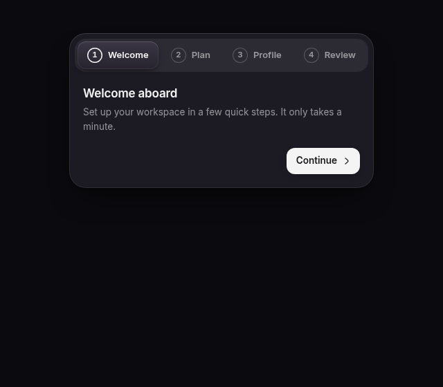 |  | 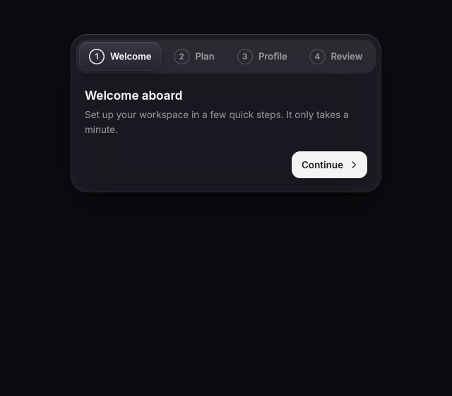 |
| s2 · Plan |  | 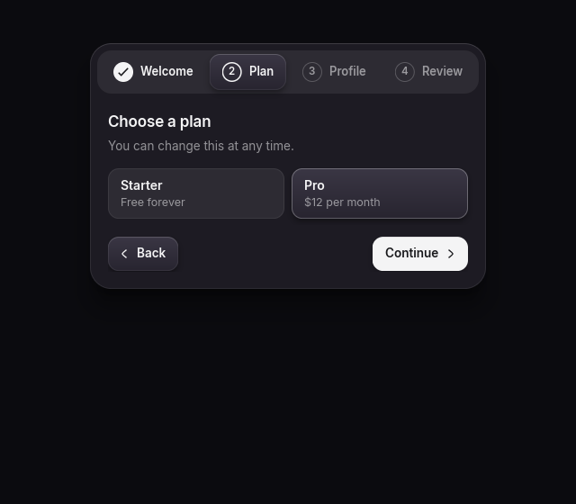 |  |
| s3 · Profile, empty | 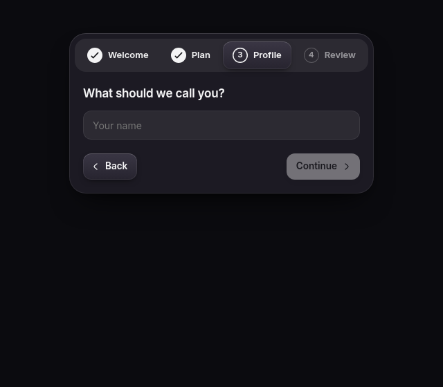 | 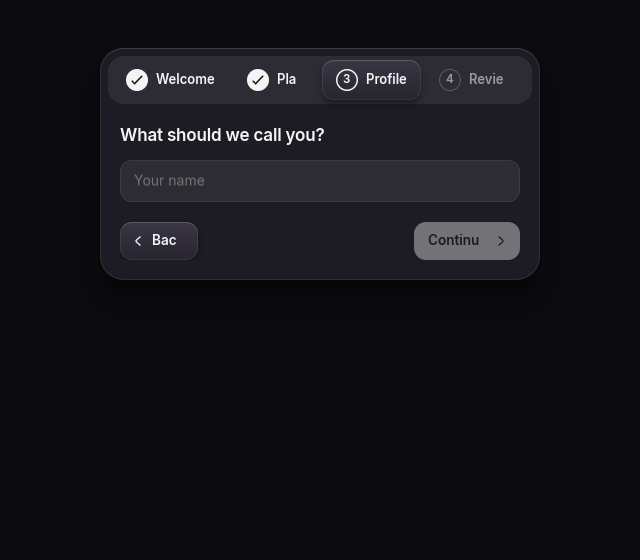 | 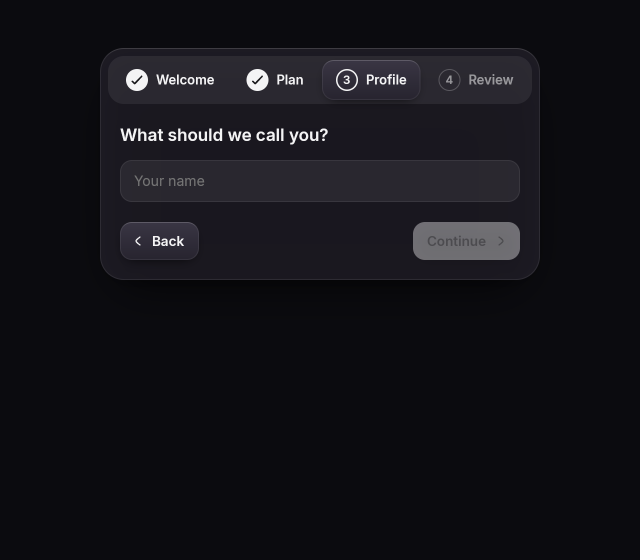 |
| s4 · Profile, "Ada" | 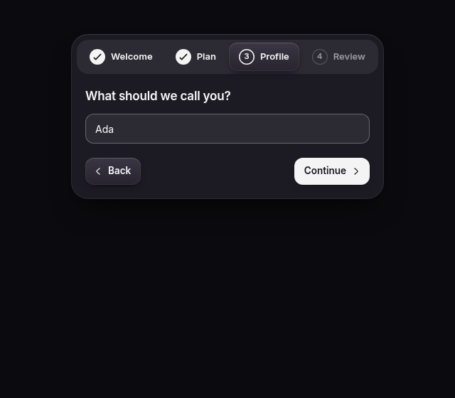 | 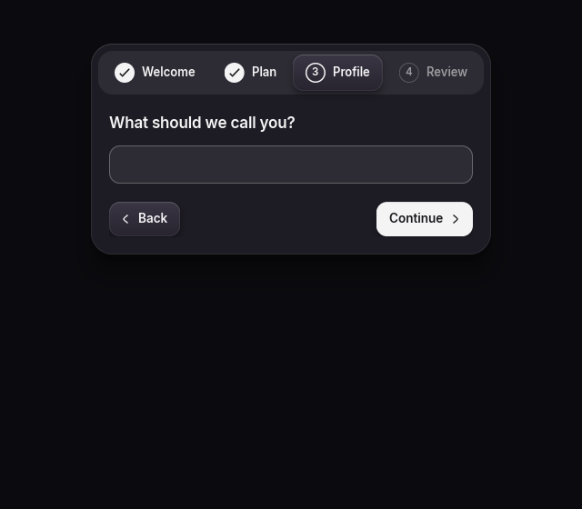 |  |
| s5 · Review | 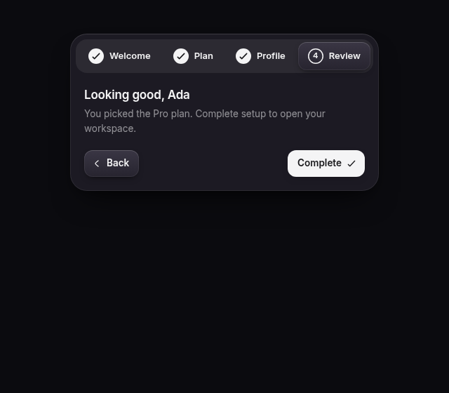 | 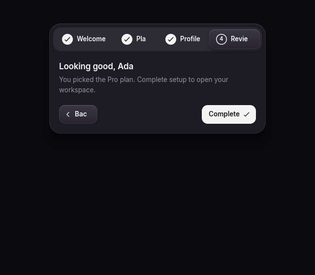 | 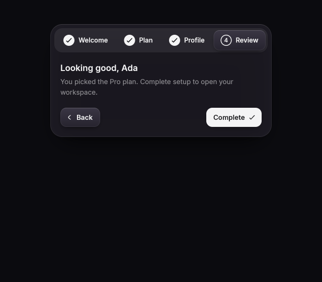 |
| s6 · Completed |  | 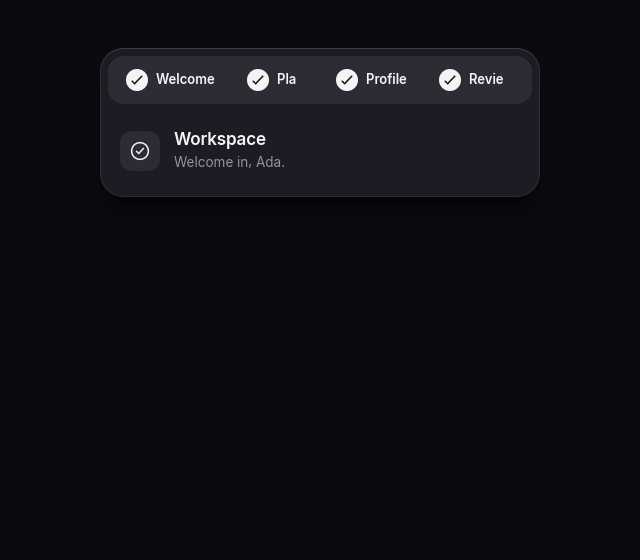 | 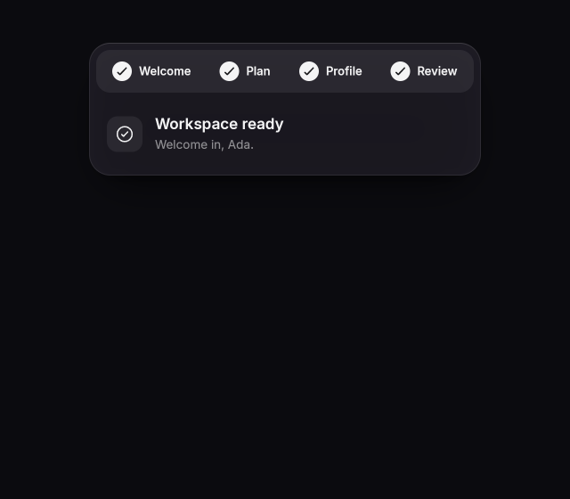 |

## Cost & Performance

Measured on AMD Ryzen + Radeon 780M (Vulkan, Wayland, `rustc 1.99.1`). Windowed Peak RSS is read from `/proc`
after the window has drawn for 3 s; engine-only numbers come from [`docs/benchmarks.md`](../../docs/benchmarks.md).

| Metric | Electron (Chromium + Node) | GPUI (native Rust) | JSNIR · QuickJS-ng (default) | JSNIR · QuickJS `.jsbc` AOT | JSNIR · V8 JIT (`jsnir-v8`) |
| --- | ---: | ---: | ---: | ---: | ---: |
| Nonblank source lines for the screen | ~350–400 (JSX+CSS) | 1,162 + 574 field | **390 (TSX)** | **390 (TSX)** | **390 (TSX)** |
| Stripped windowed release binary | ~180–260 MB | 19.6 MB | **19.97 MB** ¹ | **19.97 MB** ¹ | ~64 MB |
| Stripped headless engine binary | N/A | N/A | **6.41 MiB** | **6.41 MiB** | 50.62 MiB |
| Windowed Peak RSS (Vulkan) | ~200–350+ MB | **109 MB** | 121 MB | 121 MB | ~136 MB |
| Cold mount + settle (`STEPPER`) | ~400–1,500 ms | ~15–40 ms | **3.97 ms** | **1.42 ms** | **5.22 ms** |
| Dev hot reload | ~50–300 ms | 5–74 s (Rust rebuild) | **2.21 ms** | — | **0.47 ms** |
| Heavy JS compute (200-msg parser) | Fast (V8) | Native Rust | 1,189 µs | 1,189 µs | **33.2 µs (35.8×)** |

¹ The stripped `jsnir-gpu --features stepper` binary (`19.97 MB`, up from `15.0 MB` pre-AccessKit) bundles full
`wgpu`, **AccessKit** (`AT-SPI`/`zbus`), native **Wayland `zwp_text_input_v3` IME**, QuickJS-ng, and 20
embedded demo/test apps without LTO.

## The same button in each

The Continue button: hover darkens it, pressing scales it to 0.96, and it fades to 40 % while the name is
missing. In JSNIR the screen declares the states and transitions, and Rust runs them every frame at the
monitor's native refresh rate without calling JS:

```tsx
<Row
    style={{ height: 38, align: "center", gap: 6, padding: [0, 11, 0, 14], shrink: 0 }}
    disabled={needsName}
    onPress={() => go(current.value + 1)}
    paint={() => ({
        radius: 12,
        background: solid,
        shadows: [{ y: 4, blur: 12, spread: -6, color: 0x00000080 }],
        opacity: needsName() ? 0.4 : 1,
        hover: { brightness: 0.9 },
        active: { brightness: 0.85, scale: 0.96 },
        transitions: [ease("opacity", 200), ease("brightness", 200), ease("scale", 200)],
    })}
>
```

GPUI animates an element only from 0 to 1 when an element id first appears, so each change of state keeps
`from`, `to` and a generation in the view and rebuilds the element under a new id. The same button in
[gpui/src/main.rs](gpui/src/main.rs) (`next_button`), without the press scale, which GPUI cannot do:

```rust
fn next_button(&self, cx: &mut Context<Self>) -> AnyElement {
    let (hover, disabled) = (self.next_hover, self.next_disabled);
    let last = self.current == TITLES.len();
    let mut button = div()
        .id("next")
        .flex()
        .flex_none()
        .items_center()
        .gap(px(6.))
        .h(px(38.))
        .pl(px(14.))
        .pr(px(11.))
        .rounded(px(12.))
        .text_size(px(13.5))
        .font_weight(SEMIBOLD)
        .line_height(relative(1.))
        .shadow(vec![shadow(4., 12., -6., 0.5)]);
    if !disabled.to && !self.completed.to {
        button = button
            .cursor_pointer()
            .active(|s| s.bg(bright(SOLID, 0.85)))
            .on_hover(cx.listener(|this, hovered: &bool, _, cx| {
                this.next_hovered = *hovered;
                cx.notify();
            }))
            .on_click(cx.listener(|this, _, _, cx| this.go(this.current + 1, cx)));
    }
    let button = animate(button, id("next-hover", hover.generation), hover.generation, 200, ease(), move |el, t| {
        let k = lerp(if hover.from { 0.9 } else { 1. }, if hover.to { 0.9 } else { 1. }, t);
        el.bg(bright(SOLID, k))
            .text_color(bright(SOLID_INK, k))
            .child(if last { "Complete" } else { "Continue" })
            .child(icon(if last { Icon::Tick } else { Icon::ArrowRight }, 16., 2., bright(SOLID_INK, k), None))
    });
    // `justify_between` alone: Taffy shifts an auto margin combined with `gap` by one gap.
    animate(div().child(button), id("next-disabled", disabled.generation), disabled.generation, 200, ease(), move |el, t| {
        el.opacity(lerp(if disabled.from { 0.4 } else { 1. }, if disabled.to { 0.4 } else { 1. }, t))
    })
}
```

Each `from`/`to`/`generation` triple is updated in the view whenever the hover or the disabled state changes.

## What each stack provides

| Feature | Electron / Chromium | JSNIR (QuickJS-ng & V8 JIT) | GPUI 0.2.2 |
| --- | --- | --- | --- |
| CSS-like transitions (from on-screen value) | built in | built in (`transitions`, incl. `radius`) | hand-written per property |
| Spring `linear()` easing, cubic-bezier | built in | built in | hand-written ([motion.rs](gpui/src/motion.rs)) |
| Hover / press / focus states | built in (`:hover`, `:active`, `:focus`) | built in (`hover`, `active`, `focus`) | listeners + view state |
| Enter & exit animations | `@starting-style` + JS/Web Animations | built in (`starting` + `exiting` frozen snapshots) | new element id per generation |
| Glider following the active step | layout + transition | `follow` + `left`/`width` transitions | measured after prepaint, extra frame |
| Viewport height animating to content | JS measurement | `height` transition | measured after prepaint |
| Inset ring and top highlight | `box-shadow: inset` | built in (`edge`, `edgeSides`, `highlight`) | absolute overlay divs |
| Press scale `scale(0.96)` | yes | yes | **no** (no transforms on divs) |
| Heading `letter-spacing: -0.01em` | yes | yes | **no** (no letter spacing) |
| Native multiplatform IME | Chromium IME | built in (Wayland v3, Win32 IMM32/TSF, X11, macOS) | 574 lines adapted from example |
| Native accessibility + `Tab` focus | Chromium a11y | built in (**AccessKit** + `Tab`/`Shift+Tab` + modal trap) | partial / custom |
| App logic off the UI thread | no (renderer main thread) | **yes** (QuickJS-ng or V8 off-UI thread) | no (UI thread) |

## Interaction and animation checks

- The comparison reports differences across the six settled states.
- `src/host.rs` has an end-to-end test that drives the JSNIR stepper through the host as a window would:
  click Continue, pick a plan, type a name (Continue stays disabled while it is empty), complete, and go back
  with a header click, with JS answering from its own thread and the leaving pane removed by its timer.
- Transition tests check the easing curves against CSS. See [Transition tests](../../src/motion.rs),
  [Full Benchmarks](../../docs/benchmarks.md), and [Roadmap](../../docs/roadmap.md).
